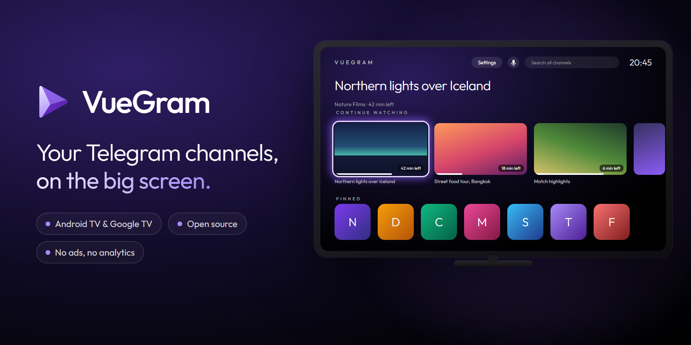

<div align="center">



<br>

**An open-source Android TV and Google TV app for the Telegram groups and channels you follow.**<br>
Their videos on the big screen, streamed straight from Telegram. *Say it "view-gram".*

[](https://docs.vuegram.com/guide/getting-started)
[](https://github.com/vuegram/vuegram/releases/latest)
[](LICENSE)
[](https://docs.vuegram.com/guide/privacy)

[**Download**](https://github.com/vuegram/vuegram/releases/latest) · [**Docs**](https://docs.vuegram.com) ·
[**Website**](https://vuegram.com)

</div>

## Install in a minute

1. On the TV, open [Downloader](https://play.google.com/store/apps/details?id=com.esaba.downloader) (free on the Play
   Store), type **`vuegram.com/get`** and choose **Install**.
2. Open VueGram and scan its QR code with your phone to send your Telegram API ID and hash (free from
   [my.telegram.org](https://my.telegram.org/apps); your phone must be on the TV's Wi-Fi).
3. Scan the login code with Telegram on your phone (**Settings › Devices › Add Device**). No SMS, no typing
   with the remote.

VueGram keeps itself up to date from then on. Step by step: [Getting started](https://docs.vuegram.com/guide/getting-started).

## What it does

- **Your library:** the groups and channels you follow as a grid of their photos. **Continue watching** and **New in
  your channels** (from the chats you pin) sit on top as rows that scroll sideways. Hold OK to pin or hide a chat;
  your Telegram folders become tabs.
- **A player made for the remote:** OK pauses, left and right skip, number keys jump to 10–90 %. Up next, subtitles,
  audio tracks, speed and a sleep timer. It falls back to another decoder, then to software decoding, and opens the
  rare file it can't play in [mpv-android](https://github.com/mpv-android/mpv-android).
- **Search** across every group and channel, by typing or with the TV's **voice search**.
- **Picks up where you left off:** your place in every video, what you've watched and what you've hidden.
- **12 languages,** fully right-to-left in Arabic, Hebrew and Persian.
- **Private by design:** no accounts, servers, ads or analytics. Your Telegram data goes between your TV and
  Telegram, and nowhere else. The one other request is the update check, to GitHub.

Out of the box VueGram shows groups and channels only, never private chats or bots; *Settings › Show people* adds
them.

## How it works

```
Telegram ──► TDLib inside VueGram ──► stream server on 127.0.0.1 ──► player
             └──────────────────────── all on your TV ─────────────────────┘
```

VueGram is built on Telegram's own library, [TDLib](https://github.com/tdlib/td). Videos stream through a small server
inside the app, reachable only from the TV itself with a one-time token, and the parts you watch are deleted
afterwards. Updates are installed only when their checksum matches and they're signed with VueGram's key. More in
[Privacy & security](https://docs.vuegram.com/guide/privacy).

## For developers

JDK 17 and the Android SDK (platform 36), then `./gradlew assembleDebug`. Before sending a change,
`./gradlew testDebugUnitTest lintDebug assembleDebug` must pass.

- [Building from source](https://docs.vuegram.com/developers/building) · [Releasing](https://docs.vuegram.com/developers/releasing) ·
  [TDLib, built from source](https://docs.vuegram.com/developers/tdlib)
- [CONTRIBUTING.md](CONTRIBUTING.md), [SECURITY.md](SECURITY.md), and for coding agents [AGENTS.md](AGENTS.md)

## License

MIT, see [LICENSE](LICENSE). VueGram includes TDLib, OpenSSL, the Outfit font and other open-source software under
their own licences, listed in [THIRD_PARTY_NOTICES.md](THIRD_PARTY_NOTICES.md).

---

<sub>VueGram is an unofficial app built on Telegram's own library. It is not made by, affiliated with or endorsed by
Telegram.</sub>
